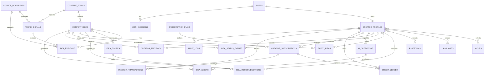

# CreatorPulse Entity Relationship Diagram

MongoDB does not enforce relational foreign keys. This Mermaid ER diagram shows logical references and cardinality for review; implementation uses MongoDB collections and application-enforced references.

## Cardinality notes

- A creator has one active profile in MVP, but profile history is represented through `profileVersion` rather than separate profile documents.
- A content idea is reusable across creators; creator-specific saves, recommendations, assets and feedback are separate records.
- A score is versioned because ranking logic and source coverage can change.
- A generated asset belongs to both an idea and a creator, and references the AI operation that produced it.
- A credit ledger is append-only and may contain multiple entries for one generation operation: reservation, consumption, release or refund.
- Social-platform account entities are intentionally absent from the MVP diagram because direct publishing is P1/V2.
