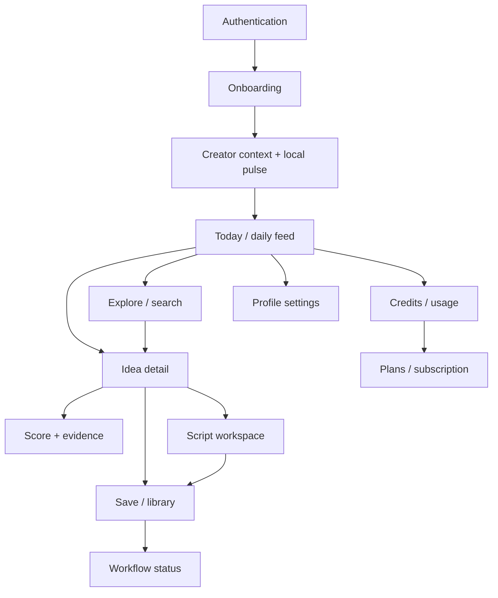
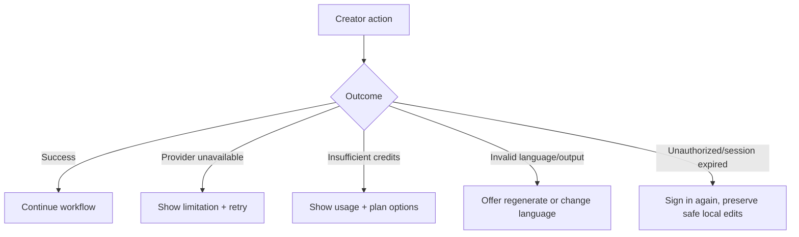

# CreatorPulse User Flows

**Status:** Frozen for implementation planning — rural-first new-script pipeline

## 1. Information architecture

## 2. First-session flow

Signup → welcome/profile → choose niches → choose platforms → choose languages → describe audience/style → confirm → daily feed.

Design intent: show progress, explain why each preference matters, allow back navigation, collect an explicit coarse location choice, and reach the first grounded local idea in as few steps as possible.

Location setup is consent-first. The creator may choose country, region and city manually, or explicitly allow approximate location once. Declining location permission never blocks onboarding; the app falls back to the selected country or a national signal. The creator can change or remove this context in Settings.

## 3. Daily idea-to-script flow

Today → see the Local pulse → choose the featured grounded recommendation → inspect “why this idea?” and local evidence → confirm audience/language/platform/duration/cost → write a short “what I want to say” brief → generate hooks/script/CTA → edit → mark ready for tomorrow → optionally give feedback.

Success criteria:

- The recommendation rationale is visible before detail navigation.
- Score and evidence are understandable without technical terms.
- Credit cost is visible before generation.
- Generation failure does not lose the idea or edits.
- Local relevance is never shown without a location label, freshness time and source disclosure.
- Gemini interpretation is separated from observed source evidence.

## 3.1 Tomorrow-script planner

`New script` must open a planner, not an unexplained search result.

1. **Choose a starting point:** recommended idea (primary) or my own topic (secondary).
2. **Confirm the brief:** show the idea/topic, target audience, niche, language, platform, duration and credit cost. Allow context edits before generation.
3. **Set expectations:** explain that the result contains three hooks, one spoken script and one CTA, and that every line can be edited.
4. **Generate:** show “Reviewing your audience,” “Writing your script” and “Checking language” states; preserve the brief if generation fails.
5. **Make it yours:** choose a hook, edit the spoken script and CTA, review safety/claim notes and copy the final draft.
6. **Ready for tomorrow:** persist the draft and transition the idea to `scripted` or the approved ready-for-tomorrow state. The completion action must be explicit and reversible.

The own-topic path accepts a creator’s plain-language starting point without requiring a research result first. If research is unavailable, explain the limitation and still allow a clearly labelled draft with appropriate evidence/safety caveats.

## 3.2 Local pulse and grounded Gemini stages

1. **Find local signals:** permitted research adapters collect current, attributable source items for the creator’s coarse location, niche, language and platform.
2. **Choose an angle:** Gemini receives only the bounded source bundle and returns candidate angles with source references, freshness and uncertainty. It must not fabricate a local trend when evidence is missing.
3. **Creator brief:** the creator selects one angle and writes one short sentence describing what they want to say.
4. **Write the script:** Gemini expands the selected angle and brief into the requested duration, language and platform format.
5. **Review:** show the evidence, generated content, safety/claim notes and edit controls together before the creator marks the script ready.

The product must show a source outage or weak local coverage as a limitation, not as a blank screen and not as a confident AI-generated trend.

## 3.3 Rural-first new-script pipeline

The product should hide the complexity of the research and generation pipeline behind five simple creator decisions. On every step, use one question, one primary button and a short explanation of what happens next.

| Step                 | Creator sees                                                                       | Primary action    | Pipeline work behind it                                                                                           |
| -------------------- | ---------------------------------------------------------------------------------- | ----------------- | ----------------------------------------------------------------------------------------------------------------- |
| 1. Choose an idea    | One recommended local idea plus “Use this idea” and “I have my own topic”          | Use this idea     | Retrieve fresh permitted signals, apply location/niche/language filters, rank with grounded Gemini interpretation |
| 2. Say your message  | “What do you want to say?” with a short text box and future voice-input affordance | Continue          | Combine the creator’s message with the selected idea and evidence bundle                                          |
| 3. Confirm format    | Pre-filled language, platform and duration; only the duration is prominent         | Create my script  | Apply creator profile defaults and generation limits                                                              |
| 4. Create the script | “Finding the angle”, “Writing your words” and “Checking the script”                | Review my script  | Generate hooks, full spoken script and CTA; run language, safety and unsupported-claim checks                     |
| 5. Review and save   | Short sections designed for reading aloud, with edit and alternate-hook actions    | Save for tomorrow | Persist the draft, evidence and review state                                                                      |

### Copy and interaction rules

- Prefer “Today’s idea for you” over “trend intelligence”, “signal” or “content opportunity”.
- Prefer “Tell us what you want to say” over “Enter a creative brief”.
- Prefer “Make my script” over “Generate draft”.
- Prefer “Save for tomorrow” over “Publish” until the creator explicitly enters a publishing flow.
- Use everyday examples such as “a quick fitness tip”, “a festival food idea” or “a local business story”.
- Keep one primary action visible at the bottom of each step; do not make the creator search for the next button.
- If the creator chooses their own topic, skip the trend explanation and go directly to the message step.
- If local evidence is weak, say “We could not find enough local signals. We can still make a useful script from your topic.”
- If generation fails, preserve the creator’s text and show “Your words are safe. Try again” with one retry action.

### Language and access considerations

Onboarding language, selected platform and usual duration should carry forward automatically. Hindi, Bhojpuri and other supported languages should be the visible labels and examples when selected; English may appear as a small secondary label only when needed. A future voice-input path should transcribe into the same short message field and let the creator edit the transcription before generation. It should not be required for the first release.

The flow should remain usable on a slow connection: show cached context while fresh signals load, load text before images, keep progress states stable, and never discard typed content after a timeout or retry.

## 4. Search flow

Explore → enter topic → choose optional niche/platform/language filters → view ideas → refine if signals are sparse → open detail → save or generate.

Empty behavior: explain that no strong trend signal was found, then offer related topics or a broader search rather than a dead end.

## 5. Library flow

Library → filter by saved/planned/scripted/published/dismissed → open idea → view evidence/assets → update status or generate another asset.

MVP “published” is a manual status; the UI must not imply that CreatorPulse published the video.

## 6. Credit and subscription flow

Credit meter → select billable action → see operation cost and remaining balance → confirm → reserve credits → progress/result → settle or refund.

When insufficient: preserve context, explain the limit, show plan options and provide a safe back action. Mock/manual checkout states must be labeled as such until real payments are connected.

## 7. Failure flows

## 8. Responsive flows

- Mobile prioritizes one idea at a time, sticky save/generate actions and bottom navigation.
- Desktop supports side-by-side idea/evidence and score/action panels.
- Script editing remains full-width on mobile; score/evidence becomes a collapsible drawer.
- Filters become a bottom sheet on mobile and inline chips on desktop.
