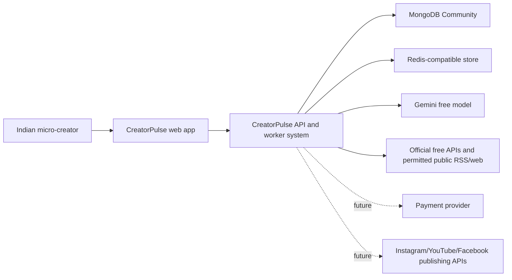
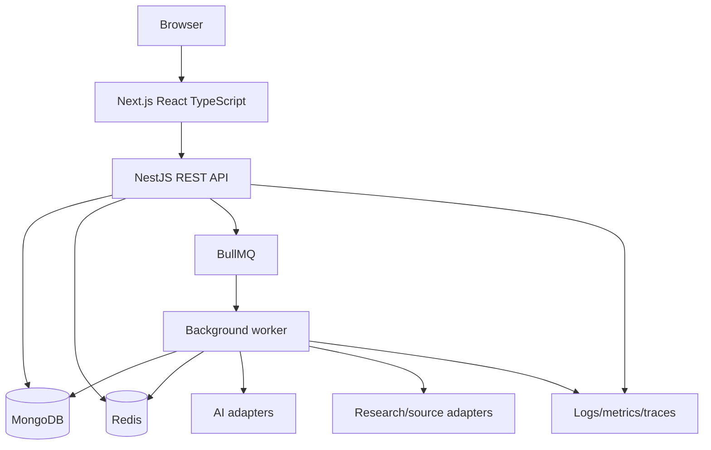
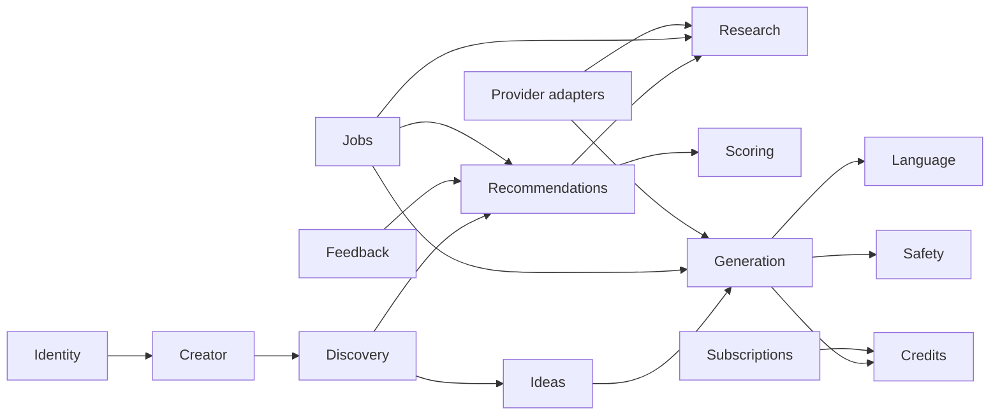
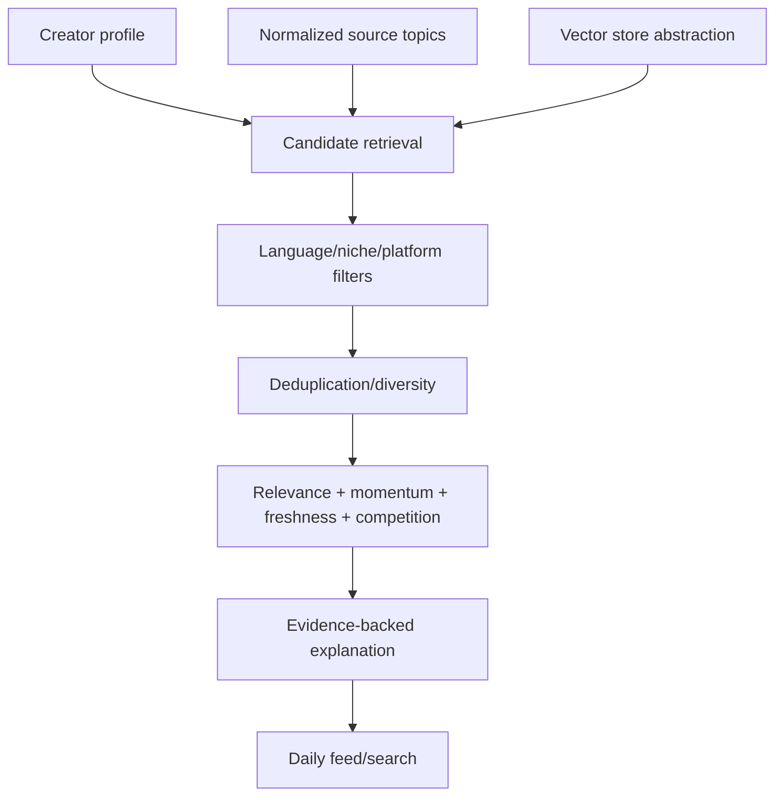
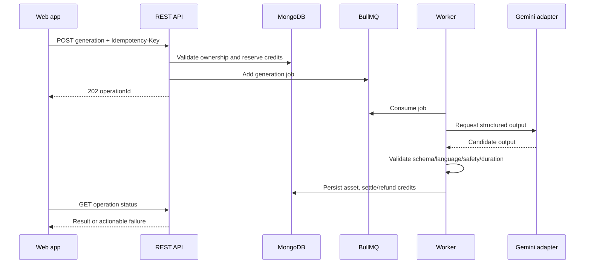
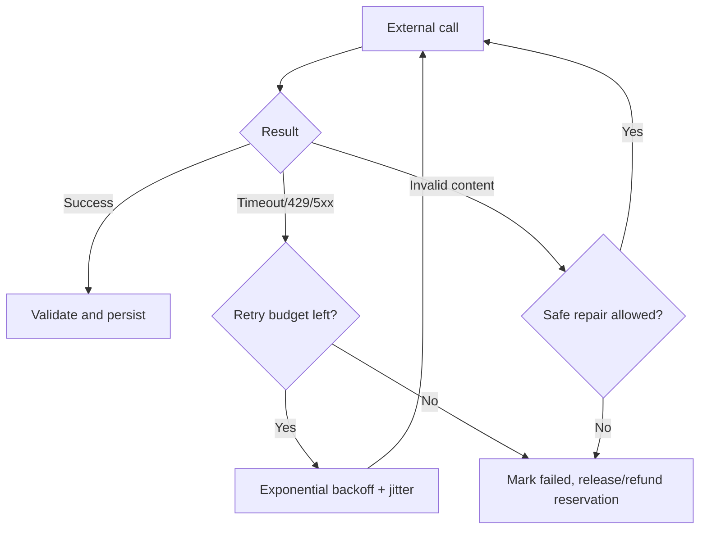
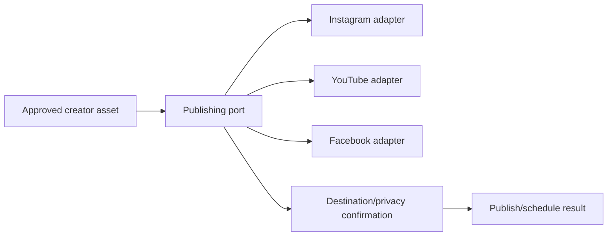

# CreatorPulse Architecture Diagrams

These diagrams describe the approved MVP engineering direction: a modular NestJS monolith, a separate worker process, MongoDB-first persistence, Redis/BullMQ asynchronous work and replaceable provider adapters.

## 1. Context diagram

## 2. Container diagram

## 3. Module dependency diagram

## 4. Discovery and ranking flow

## 5. Asynchronous generation sequence

## 6. Failure and retry flow

## 7. Future publishing boundary

The publishing boundary is intentionally not connected to MVP user flows. It exists only as a future integration seam.
