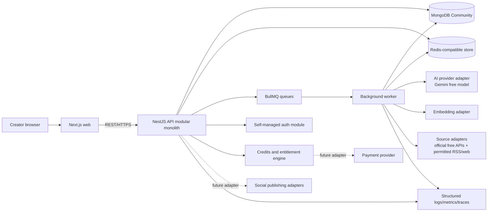
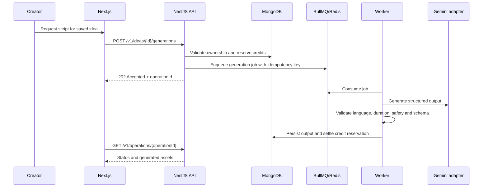
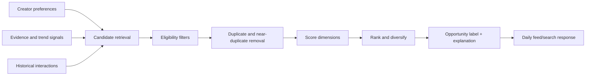
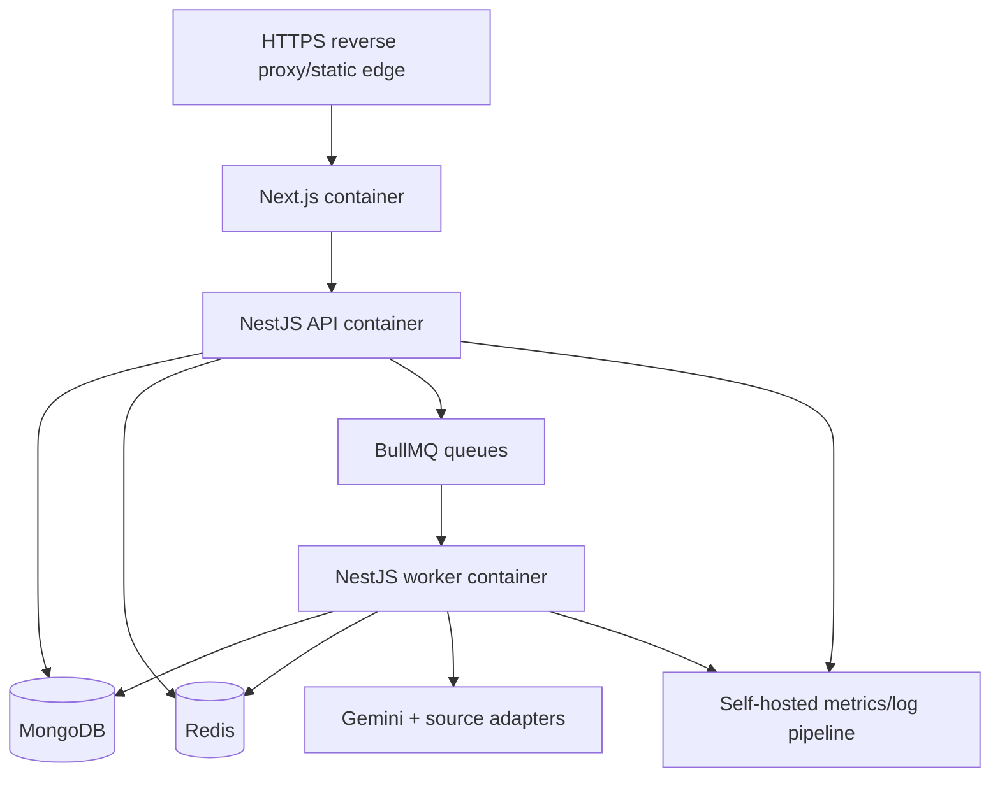

# CreatorPulse Engineering Design

**Status:** Draft for engineering approval  
**Phase:** 2 — Engineering design  
**Date:** 2026-11-10  
**Source of truth:** `/docs/product/PRD.md`

## 1. System overview

CreatorPulse will be implemented as a modular monolith with a separate background-worker process. The web application consists of a Next.js/React frontend and a NestJS REST API. MongoDB is the system of record. Redis-compatible infrastructure supports queues, scheduling, rate limiting and short-lived caching. AI and research providers are accessed through replaceable ports.

The MVP is designed to run with free/open-source components and free quotas. Production payment processing, direct publishing and paid AI/data providers are adapter-ready but not required for the MVP implementation.

### MVP runtime units

1. **Web:** Next.js application for authenticated creator workflows.
2. **API:** NestJS modular monolith exposing REST contracts.
3. **Worker:** NestJS-compatible worker process consuming BullMQ jobs.
4. **MongoDB Community:** creator, idea, evidence, feedback, credit and entitlement persistence.
5. **Redis-compatible store:** BullMQ backend, cache, locks and rate-limit counters.
6. **Provider adapters:** Groq primary with Gemini fallback, permitted trend sources, embeddings, email and payment simulation. AI-05 supersedes legacy Gemini-only references below; see `AI_PROVIDERS.md` for authoritative routing/configuration.

## 2. Architecture principles

### Additive video pilot boundary (2026-11-13)

The planned video module extends an approved script revision through scene planning, creator narration, timed captions and export. See [`VIDEO_PILOT.md`](../product/VIDEO_PILOT.md) for the detailed contract/technology plan and E15 in the task catalog for acceptance criteria. Use `ScenePlanner`, `Transcriber`, `VideoRenderer` and `MediaStorage` ports; deterministic templates, self-hosted Whisper, SVG/React and a license-eligible Remotion/FFmpeg toolchain must operate with paid providers and Gemini disabled.

Persist versioned project/media/export metadata in MongoDB and bytes in local storage behind a portable adapter. A dedicated bounded BullMQ render queue must not block API requests or starve script generation. Revisions/hashes enable cache reuse and idempotent renders; narration measurement drives timing. Enforce creator ownership on every media/project/export/download path, validated media inputs, immutable export manifests, atomic video allowances separate from script credits, bounded retries and crash recovery. Benchmark upload/resource/global limits before inviting users; make file expiry and deletion part of the same lifecycle. Cloud storage, paid AI voices and generated cinematic clips require later approval. This is a planned architecture, not implemented functionality.

### Core principles

- Keep the MVP deployable as a small number of processes.
- Enforce business boundaries through NestJS modules and ports, not network calls.
- Keep external providers behind interfaces and normalized internal contracts.
- Treat AI output as untrusted data requiring validation, provenance and safety checks.
- Make asynchronous work durable, observable and idempotent.
- Keep credit reservation and settlement authoritative in the API/database path.
- Prefer open standards, Docker-based local development and portable deployment.
- Do not introduce a second database until retrieval quality or scale proves it necessary.
- Make platform integrations additive adapters, not cross-cutting conditionals.

## 3. High-level architecture



## 4. Low-level component architecture

### API process

- HTTP controllers validate transport DTOs and map errors to the public error contract.
- Application services coordinate use cases and transactions.
- Domain services calculate business rules such as score labels, credit costs and status transitions.
- Repositories hide MongoDB-specific persistence details.
- Ports define AI, embeddings, source, payment, notification and future publishing contracts.
- Guards and policies enforce identity, ownership, role and entitlement checks.

### Worker process

- Queue consumers handle research ingestion, idea enrichment, embeddings, recommendation refresh and generation.
- Workers are idempotent and use deterministic job keys where possible.
- External calls have bounded retries, exponential backoff and provider-specific rate limits.
- Completed outputs are validated before persistence and credit settlement.

### Logical request flow



## 5. Frontend architecture

### Stack

- React with Next.js and TypeScript
- Server-rendered or statically rendered public/auth entry points where useful
- Client-side data fetching for authenticated, changing data
- Shared design system and accessible form/control primitives
- Typed API client generated or maintained from the REST contract

### Frontend boundaries

- `app`: route composition and layouts
- `features/auth`: login, signup, refresh and session state
- `features/onboarding`: profile preferences and validation
- `features/discovery`: daily feed, search, filters and idea cards
- `features/idea`: detail, evidence, score, save and status actions
- `features/generation`: hook/script/CTA request and operation polling
- `features/library`: saved ideas and status views
- `features/billing`: credits, plans and entitlement display
- `features/feedback`: voluntary ratings and reasons
- `shared/api`: typed REST client and error mapping
- `shared/ui`: accessibility-tested components

The frontend must not calculate authoritative scores, credits, entitlements or permissions. It may optimistically update non-authoritative UI state, but the API remains the source of truth.

### Frontend data handling

- Cache read-heavy feed/detail responses with short client cache lifetimes.
- Invalidate idea/library/credit queries after mutations.
- Poll or use short-lived status refresh for asynchronous generation; WebSockets are not required for MVP.
- Preserve unsaved script edits locally during regeneration or transient failures.

## 6. Backend architecture

NestJS is organized as a modular monolith. Modules communicate through application services and explicit interfaces. Controllers do not call providers or repositories directly.

### Cross-cutting backend layers

1. Transport: REST controllers, DTO validation, versioning and serialization.
2. Application: use cases, orchestration and transaction boundaries.
3. Domain: scoring rules, statuses, credit policies, safety policies and ownership rules.
4. Infrastructure: MongoDB repositories, Redis queues/cache, Gemini adapter and source adapters.

## 7. Module boundaries and responsibilities

| Module                | Owns                                                                | Does not own                     |
| --------------------- | ------------------------------------------------------------------- | -------------------------------- |
| Identity              | signup, login, refresh, logout, password reset hooks, sessions      | creator preferences or billing   |
| Creator               | profile, niche, audience, platforms and languages                   | recommendation ranking           |
| Discovery             | feed composition, search orchestration and idea retrieval           | raw ingestion scheduling         |
| Ideas                 | idea lifecycle, saved items, statuses and idea detail               | provider-specific trend crawling |
| Research              | evidence, source provenance, freshness and research jobs            | final script wording             |
| Scoring               | relevance, momentum, freshness, competition and labels              | source acquisition               |
| Recommendations       | candidate generation, filtering, ranking and deduplication          | payment/credits                  |
| Generation            | hooks, scripts, CTAs and output validation                          | user profile ownership           |
| Language              | language detection, normalization, quality checks and prompt policy | billing                          |
| Feedback              | voluntary feedback and quality signals                              | immediate model retraining       |
| Credits               | reservations, consumption, refunds and usage ledger                 | payment collection               |
| Subscriptions         | plans, entitlements, renewal state and payment adapter boundary     | generation logic                 |
| Jobs                  | queue registration, job status and scheduling policies              | domain persistence rules         |
| Platform integrations | normalized external client contracts and future publishing adapters | core idea state                  |
| Safety                | claim/risk checks, reporting and policy decisions                   | source ingestion                 |
| Observability         | logs, metrics, trace context and provider telemetry                 | business decisions               |

## 8. Authentication and authorization

### Authentication

- Store passwords only as Argon2id hashes with tuned parameters documented per environment.
- Issue short-lived access JWTs and rotating refresh tokens.
- Store refresh-token hashes and session metadata so individual sessions can be revoked.
- Prefer secure, HttpOnly, SameSite cookies for browser refresh tokens; do not expose long-lived refresh tokens to JavaScript.
- Apply login throttling, password reset token expiry and account lockout/risk controls.
- Never log passwords, tokens, provider keys or authorization headers.

### Authorization

- Default role: creator.
- Administrative/operator role is internal and protected separately.
- Every creator-owned read/write checks resource ownership in the application service.
- Entitlement guards check plan status and available credits before billable operations.
- Future publishing scopes are isolated from MVP creator permissions.

## 9. API architecture and endpoint specifications

### API conventions

- Base path: `/v1`
- JSON request/response bodies
- ISO-8601 timestamps in UTC
- Cursor pagination for feeds, search and library
- `Idempotency-Key` required for billable or mutating asynchronous operations
- Consistent envelope for operation status and error details
- OpenAPI generated from NestJS DTOs and reviewed as a public contract

### Authentication

| Method | Endpoint        | Purpose                                         |
| ------ | --------------- | ----------------------------------------------- |
| POST   | `/auth/signup`  | Create account and initial session              |
| POST   | `/auth/login`   | Authenticate creator                            |
| POST   | `/auth/refresh` | Rotate refresh token and issue access token     |
| POST   | `/auth/logout`  | Revoke current session                          |
| GET    | `/me`           | Return current identity and entitlement summary |

### Creator profile

| Method | Endpoint           | Purpose                          |
| ------ | ------------------ | -------------------------------- |
| GET    | `/creator/profile` | Read profile/preferences         |
| PUT    | `/creator/profile` | Replace validated preference set |
| PATCH  | `/creator/profile` | Update selected preferences      |

### Discovery and ideas

| Method | Endpoint                 | Purpose                                        |
| ------ | ------------------------ | ---------------------------------------------- |
| GET    | `/feed/daily`            | Retrieve ranked daily recommendations          |
| GET    | `/ideas/search`          | Search/filter researched ideas                 |
| GET    | `/ideas/{ideaId}`        | Read idea, score, evidence and assets          |
| POST   | `/ideas/{ideaId}/save`   | Save/bookmark an idea                          |
| DELETE | `/ideas/{ideaId}/save`   | Remove saved state                             |
| PATCH  | `/ideas/{ideaId}/status` | Set saved/planned/scripted/published/dismissed |

### Generation and operations

| Method | Endpoint                           | Purpose                                                |
| ------ | ---------------------------------- | ------------------------------------------------------ |
| POST   | `/ideas/{ideaId}/generations`      | Reserve credits and enqueue hook/script/CTA generation |
| GET    | `/operations/{operationId}`        | Read asynchronous operation state and result           |
| POST   | `/operations/{operationId}/cancel` | Cancel queued work where safe                          |

### Feedback, credits and subscriptions

| Method | Endpoint                   | Purpose                                    |
| ------ | -------------------------- | ------------------------------------------ |
| POST   | `/ideas/{ideaId}/feedback` | Submit optional feedback                   |
| GET    | `/credits`                 | Read balance, renewal and recent usage     |
| GET    | `/plans`                   | Read available plans and credit allowances |
| POST   | `/subscriptions/checkout`  | Invoke payment adapter or mock checkout    |
| POST   | `/subscriptions/cancel`    | Cancel renewal intent                      |

### Representative generation request

```json
{
  "language": "hi",
  "platform": "youtube_shorts",
  "outputs": ["hooks", "script", "cta"],
  "durationSeconds": 45,
  "tone": "conversational"
}
```

The API responds with `202 Accepted`, an `operationId`, estimated credit cost and current balance. The final result is returned only after the worker validates and persists it.

### Error contract

```json
{
  "error": {
    "code": "CREDITS_INSUFFICIENT",
    "message": "Not enough credits for this operation.",
    "requestId": "req_...",
    "details": { "required": 3, "available": 1 },
    "retryable": false
  }
}
```

## 10. AI orchestration architecture

### Provider ports

- `TextGenerationProvider`
- `EmbeddingProvider`
- `ModerationOrSafetyProvider`
- `LanguageQualityProvider`

AI-05 uses a shared Groq-first structured transport with one-way Gemini fallback and an explicit deterministic fake. Prompt templates, model configuration, output schemas and safety policies are versioned in application code/configuration, not scattered across controllers. Existing safety/credit/persistence boundaries stay outside provider failover; see `AI_PROVIDERS.md`.

### Generation pipeline

1. Validate user, idea ownership, requested language/platform and credit estimate.
2. Reserve credits using an idempotency key.
3. Load normalized idea, evidence and creator preferences.
4. Build a bounded prompt with source context and explicit uncertainty rules.
5. Request structured JSON output from the provider.
6. Validate schema, language, script duration, prohibited claims and required fields.
7. Retry only transient provider failures; do not blindly retry invalid content.
8. Persist output with model/provider/prompt-version metadata.
9. Settle credits or refund the reservation according to the outcome.
10. Expose operation status and errors without exposing provider internals.

### Prompt and output safety

- Treat web/source text as untrusted input and delimit it from instructions.
- Require the model to identify uncertainty and avoid unsupported factual claims.
- Use deterministic post-generation checks for language, duration and prohibited patterns.
- Flag finance and health-related claims for caution/disclaimer handling.
- Store only the minimum prompt/output data needed for product functionality and quality analysis.

## 11. Recommendation engine architecture

### Candidate pipeline



### MVP strategy

- Cold-start candidate generation from normalized source topics, niche/language/platform rules and curated seed concepts.
- Semantic retrieval through the vector-store port when embeddings are available.
- Deterministic weighted ranking for relevance, momentum, freshness and competition.
- Diversity constraints across topics and sources to avoid repeated ideas.
- Optional feedback signals are captured now but only influence ranking after minimum data thresholds.

The ranking engine must return score components and evidence references so explanations are derived from the same inputs as the rank.

## 12. Trend discovery and data ingestion

### Source adapters

Each source adapter implements fetch, normalize, provenance and rate-limit behavior. Initial categories are official free API quotas where available and permitted public RSS/web sources. Private-data scraping and prohibited access are not allowed.

### Ingestion flow

Fetch → validate source response → normalize topic/entity/language/date → deduplicate → store provenance → compute embeddings → calculate signals → mark freshness → publish candidate update event.

### Data quality controls

- Retain source URL, source type, observed timestamp and published timestamp where available.
- Mark missing or conflicting fields explicitly.
- Quarantine malformed or suspicious source data.
- Do not treat source count as equivalent to truth.
- Re-fetch or expire stale signals according to source-specific policy.

## 13. Regional-language processing

Supported languages are Hindi, Hinglish, Bhojpuri, Punjabi, Haryanvi, Telugu and Kannada.

- Normalize language identifiers internally; display human-friendly names in the UI.
- Preserve selected language and platform in every generation request.
- Allow controlled Hinglish/code-switching rather than applying literal translation.
- Use language-specific prompt instructions and evaluation samples.
- Validate output language with a detector plus native-speaker review during beta.
- Store quality telemetry by language, niche and platform.
- Never silently substitute English when a requested language fails; return a transparent fallback choice.

## 14. Third-party integrations

All integrations use ports and adapters.

| Integration       | MVP implementation                                                             | Future replacement                           |
| ----------------- | ------------------------------------------------------------------------------ | -------------------------------------------- |
| LLM               | Gemini free-model adapter                                                      | Paid Gemini or alternate provider            |
| Embeddings        | Configurable embedding adapter; local/free option where feasible               | Higher-quality hosted embeddings             |
| Research          | Official free quotas + permitted RSS/web adapters                              | Licensed trend/search providers              |
| Auth              | Self-managed NestJS auth                                                       | External identity provider if scale warrants |
| Payments          | Mock/manual payment adapter and internal entitlements                          | Indian payment provider adapter              |
| Social publishing | Not implemented in MVP                                                         | Platform-specific OAuth/publishing adapters  |
| Observability     | Structured logs, OpenTelemetry-compatible interfaces, self-hosted metrics/logs | Managed observability provider               |

Provider credentials and quota configuration are environment-managed. Provider-specific DTOs must not leak into domain contracts.

## 15. Background jobs and scheduling

Queues:

- `source-ingestion`
- `evidence-enrichment`
- `embedding-upsert`
- `recommendation-refresh`
- `content-generation`
- `quality-check`
- `entitlement-maintenance`

Use BullMQ job schedulers for recurring ingestion and feed refresh. Every job includes a correlation ID, logical idempotency key, creator/tenant scope where applicable, attempt count and safe retry classification.

Workers must assume at-least-once delivery. Credit settlement, persistence and external side effects must be idempotent. Long model calls must not block the event loop; concurrency is bounded per provider and queue.

## 16. Caching strategy

Redis is a performance layer, never the source of truth.

- Daily feed cache: short TTL, keyed by creator preference/version and date.
- Idea detail cache: short TTL, invalidated after evidence/status changes.
- Source response cache: source-specific TTL respecting terms and freshness needs.
- Credit/entitlement reads: very short TTL; authoritative mutations hit MongoDB.
- Rate-limit counters and distributed locks: Redis with bounded expiry.

Cache keys include language, platform and relevant preference version to prevent cross-context leakage. Cache failures degrade to MongoDB/API execution where safe.

## 17. Error handling and retry strategy

Classify errors as validation, authorization, business limit, transient provider, permanent provider, data quality or internal.

- Validation/authorization/business errors: no retry; return actionable 4xx responses.
- Transient provider/network/rate-limit errors: bounded exponential backoff with jitter.
- Permanent provider/authentication errors: fail fast and expose a recoverable action.
- Invalid AI output: one constrained repair attempt at most, then fail/refund.
- Worker crash/stall: allow queue recovery but make handlers idempotent.
- Failed billable operations: release/refund reserved credits exactly once.

Every error carries a request/operation ID. User messages are safe and concise; internal logs include provider status, latency and classification without secrets or sensitive content.

## 18. Security and privacy

- TLS in deployed environments and secure local secret handling.
- Argon2id passwords, refresh-token rotation and session revocation.
- Strict ownership checks for every creator resource.
- DTO validation, output encoding and safe rendering of source text.
- SSRF protections for any server-side URL fetching: allowlists, timeouts, size limits and private-network blocking.
- Prompt-injection defenses through source delimiting and no direct tool execution from model output.
- Encrypt sensitive secrets at rest where supported; never store payment credentials.
- Minimize retention of prompts, generated content and source payloads.
- Account deletion must remove or anonymize creator-owned data according to the approved retention policy.
- Audit authentication, entitlement, administrative and future publishing actions.

## 19. Rate limiting and abuse prevention

Apply layered limits:

- IP and account limits for signup/login.
- Account limits for search, research and generation.
- Plan/credit limits for billable operations.
- Provider-specific concurrency and quota limits.
- Payload size, URL count and source-fetch limits.
- CAPTCHA or manual review hook if abuse becomes material.

Use Redis counters with a fail-safe policy: security-sensitive limits should fail closed when the limiter is unavailable; non-critical read traffic may degrade gracefully.

## 20. Logging, monitoring and observability

### Logs

Structured JSON logs with timestamp, level, service/process, request ID, operation ID, user-safe actor ID, module, duration, outcome and error code. Redact tokens, passwords, full prompts and sensitive profile content.

### Metrics

- API latency/error rate by endpoint
- Queue depth, wait time, active jobs, retries and stalled jobs
- Provider latency, error rate, quota responses and token usage where available
- Generation validation failures by language/niche/platform
- Cache hit rate
- Credit reservations, settlements and refunds
- Recommendation impressions, saves, dismissals and feedback
- MongoDB and Redis health/resource metrics

### Traces

Trace request → database → queue enqueue → worker → provider → persistence where correlation is possible. Sampling must avoid capturing sensitive payloads.

## 21. Performance and scalability

### MVP targets to baseline in testing

- Fast authenticated reads for feed, library and idea details under normal cache hit conditions.
- Asynchronous generation and research never block the request thread.
- Bounded provider concurrency prevents one creator or source from exhausting shared quotas.
- Cursor pagination avoids large result payloads.
- Indexes and query plans are reviewed for ownership, status, language, niche, platform and timestamps.

### Growth path

1. Scale API and worker processes horizontally.
2. Separate high-cost queues and provider concurrency pools.
3. Move embeddings to pgvector or a dedicated vector service if MongoDB retrieval is insufficient.
4. Split research or generation into services only when deployment/scaling boundaries are demonstrated.
5. Introduce managed infrastructure after cost and operational needs justify it.

## 22. Deployment architecture

### Local development

Docker Compose runs Next.js, NestJS API, worker, MongoDB Community and Redis-compatible storage. Provider calls are disabled or mocked by default; Gemini use requires an explicitly configured key.

### MVP cloud deployment

Deploy web, API and worker as separate containers on a low-cost/free-tier container host where permitted. MongoDB and Redis may run as self-hosted containers or free-tier services; the deployment choice must preserve backup and recovery capability.



Secrets are injected through the deployment environment. CI must run linting, unit tests, contract tests, security checks and container builds before deployment. Backups, restore tests and migration procedures are required before handling real creator data.

## 23. Testing strategy

- **Unit:** domain scoring, labels, credit ledger, status transitions, safety rules and provider error classification.
- **Integration:** MongoDB repositories, Redis queues, auth sessions, idempotency and cache invalidation.
- **Contract:** OpenAPI endpoint behavior and provider-port adapter contracts.
- **AI evaluation:** fixed multilingual test sets for language fidelity, duration, safety, unsupported claims and structured output validity.
- **Recommendation evaluation:** offline relevance, duplicate rate, diversity and score-explanation consistency.
- **End-to-end:** signup → onboarding → feed → evidence → generation → save/status → credits.
- **Failure tests:** provider timeout, rate limit, malformed output, worker crash, duplicate job, Redis outage and payment-adapter failure.
- **Security:** dependency scanning, authentication abuse, authorization bypass, SSRF, injection and secret-leak checks.
- **Load:** feed/search concurrency, queue throughput and provider quota behavior.

## 24. Cost optimization

- Use Gemini free quotas with hard per-user and global budgets.
- Cache normalized research and embeddings; avoid regenerating identical work.
- Reserve credits before expensive work and deduplicate by content/version hash.
- Use smaller/cheaper models or deterministic logic for classification and score labels where quality permits.
- Batch ingestion and embeddings.
- Keep prompts compact and include only relevant evidence.
- Expire or archive stale source payloads while retaining provenance.
- Use open-source/self-hosted logging and metrics initially.
- Feature-flag paid-provider fallbacks rather than silently incurring cost.

## 25. Technical risks and trade-offs

| Risk/trade-off                                      | Decision/mitigation                                                           |
| --------------------------------------------------- | ----------------------------------------------------------------------------- |
| MongoDB-only vector retrieval may be insufficient   | Hide behind `VectorStore`; evaluate quality and migrate to pgvector later     |
| Free Gemini quota may be too limited                | Queue, rate-limit, cache, deduplicate and keep provider adapter replaceable   |
| Free public data is incomplete                      | Preserve provenance, expose gaps and support source adapters                  |
| Self-managed auth increases security responsibility | Use standard primitives, strong tests and a narrow MVP surface                |
| Mock payment does not validate real checkout        | Keep entitlement contracts real; add provider adapter before monetized launch |
| Broad languages/niches increase QA cost             | Language/niche test matrices and per-segment quality telemetry                |
| At-least-once jobs can duplicate work               | Idempotency keys, unique operation states and credit settlement guards        |
| Modular monolith can grow unwieldy                  | Enforce module ownership, dependency direction and architecture tests         |
| Direct publishing is deferred                       | Keep platform port and permissions model separate from MVP idea workflows     |

## 26. Implementation boundaries and non-goals

This design does not define database schemas, UI implementation details, direct social publishing, production payment-provider integration or an exact cloud vendor. Those decisions require the next implementation planning step or explicit product/engineering approval.
