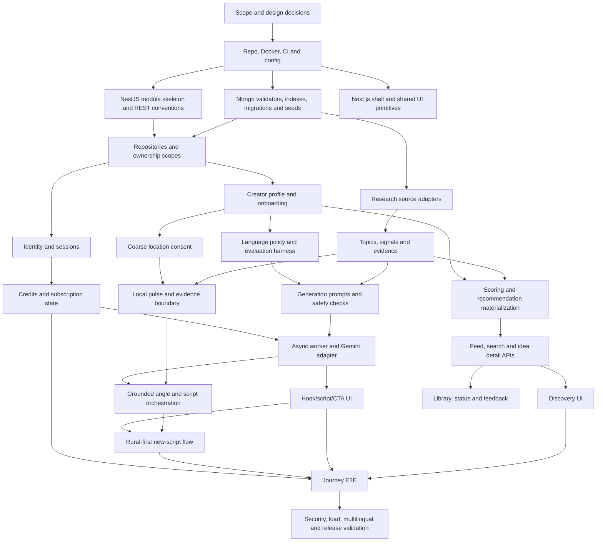

# CreatorPulse Dependency Map

## 1. Workstream dependency graph

## 2. External dependencies

| Dependency                          | Required for                                 | Failure strategy                                                            | Owner           |
| ----------------------------------- | -------------------------------------------- | --------------------------------------------------------------------------- | --------------- |
| Gemini free model/key/quota         | Generation and possibly language checks      | Fake provider, bounded queue, retry classification, clear unavailable state | AI/backend      |
| Permitted free research sources/RSS | Trend signals and evidence                   | Manual seed fallback, stale/partial-data labels                             | Data/backend    |
| SMTP or local mail adapter          | Password recovery and transactional messages | Development sink; retryable worker job                                      | Backend/infra   |
| Payment provider or mock adapter    | Subscription boundary                        | Mock/manual transaction path in MVP                                         | Backend         |
| MongoDB Community                   | Persistence                                  | Local Docker, backups and restore test                                      | Backend/infra   |
| Redis-compatible store              | Queues, locks, cache and rate limits         | Safe degradation for non-critical reads; fail closed for security limits    | Backend/infra   |
| Google Stitch references            | Visual implementation fidelity               | Approved design docs and screen IDs remain the fallback                     | Frontend/design |

## 3. Critical-path tasks

`CP-01` scope resolution → `INF-01` foundation → `DB-01` migrations/seeds → `BE-01` API skeleton → `ID-01` auth/profile → `RS-01` research normalization → `REC-01` scoring/ranking → `FE-03` discovery UI → `AI-03` async generation/credits → `FE-05` script workspace → `QA-06` end-to-end launch gate.

## 4. High-risk tasks requiring a proof of concept

- `RS-02`: permitted free-source feasibility and source-term review.
- `REC-02`: retrieval quality using MongoDB-first vector abstraction.
- `AI-02`: Gemini structured output, quota and latency test.
- `LANG-02`: seven-language naturalness and mixed-language detection evaluation.
- `CR-02`: credit atomicity under retries and duplicate requests.
