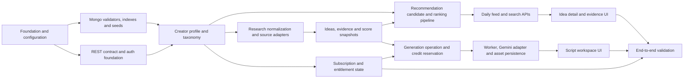

# CreatorPulse Implementation Roadmap

**P0 urgent override (2026-11-13):** Complete AI-05 Groq-primary/Gemini-fallback integration and validation before all other pending work, including VID-01–VID-07. Subtasks and gates are tracked in `TASK.md`; implementation details in `../engineering/AI_PROVIDERS.md`. Existing independent reviews and QA remain required.

**Status:** Draft for engineering-plan approval  
**Scope:** Approved MVP only; no implementation begins from this document  
**Source of truth:** PRD, Engineering Design, Database Design and approved design artifacts

**Foundation decision:** [`CP-01_DECISION.md`](./CP-01_DECISION.md) governs MVP niche scope, responsive ownership, UI chrome language and recovery behavior.

## 1. Delivery approach

CreatorPulse should be delivered as a modular monolith with three deployable runtime units: Next.js web, NestJS API and a NestJS-compatible worker. MongoDB is the system of record; Redis-compatible infrastructure supports queues, short-lived cache, locks and rate limits. AI, embeddings, research sources, email and payment are accessed through replaceable ports.

The implementation sequence is dependency-aware rather than date-based. Dates should be assigned only after the team confirms capacity, provider quotas and the availability of design assets.

## 2. MVP sequence

| Phase                           | Outcome                                                                                         | Main epics                           | Can run in parallel                                         |
| ------------------------------- | ----------------------------------------------------------------------------------------------- | ------------------------------------ | ----------------------------------------------------------- |
| 0. Readiness                    | Initial folders/tooling, scope decisions, design coverage, local toolchain and contracts agreed | Foundation, design clarification     | API contract draft, database migration plan, frontend shell |
| 1. Platform spine               | Running web/API/worker, MongoDB, Redis, CI and configuration                                    | Foundation, infrastructure, database | Auth UI shell, shared UI primitives                         |
| 2. Identity and creator context | Signup, login, sessions, onboarding and editable profile                                        | Auth, onboarding, profile            | Taxonomy seed, frontend shell                               |
| 3. Research and idea supply     | Source adapters, normalization, topics, trend signals, evidence and seeds                       | Trend ingestion, research            | Library UI, feedback UI                                     |
| 4. Discovery and trust          | Search, daily feed, scoring, evidence, explainability and deduplication                         | Discovery, recommendations, scoring  | Generation contracts, billing UI                            |
| 5. Idea execution               | Hooks, scripts, CTAs, regional-language validation and safe async operations                    | AI generation, language, safety      | Library/status implementation                               |
| 6. Commercial controls          | Plans, credits, usage, mock/manual checkout and entitlement handling                            | Subscription, credits, payments      | Observability dashboards                                    |
| 7. Hardening and launch         | E2E journey, multilingual evaluation, security, load, backups and release gates                 | QA, observability, deployment        | Documentation and runbooks                                  |

## 3. Critical path

The highest-risk path is source acquisition → normalized signals → scoring/ranking → feed usefulness. The second highest-risk path is credit reservation → asynchronous Gemini generation → settlement/refund.

## 4. Parallel workstreams

- Frontend shell, route composition and accessible primitives can proceed against mocked typed API responses after the contract is agreed.
- MongoDB validators, indexes, reference seeds and repository interfaces can proceed before all domain use cases are complete.
- Source adapters and AI provider ports can be built against fakes, provided the adapter contract and safety rules are fixed.
- Library/status, feedback and billing read views can proceed while recommendation quality is being tuned.
- Observability, CI, security scanning and test harnesses should start with the platform spine, not at the end.

## 5. Proofs of concept required before committing to full implementation

1. **Research-source feasibility:** one permitted free source plus manual seeds can produce normalized signals with provenance and freshness without prohibited scraping.
2. **MongoDB retrieval:** normalized search plus the `VectorStore` abstraction meets MVP search quality; pgvector is not added unless measured results justify it.
3. **Gemini free-model budget:** structured hooks/script/CTA generation fits quota, latency and credit assumptions under a bounded concurrency test.
4. **Multilingual quality:** the seven launch languages can pass a small human-reviewed evaluation set for naturalness, language fidelity and unsupported-claim handling.
5. **Credit atomicity:** reservation, settlement, release and refund remain correct under duplicate requests, worker retries and provider failures.

### Frozen rural-first script workstream

The approved refinement extends the idea-execution path without creating a second product flow:

`CRE-02` coarse location consent → `RS-04` local pulse and evidence → `AI-04` grounded angle/script orchestration → `FE-09` five-step new-script experience.

The creator-facing flow remains simple; location scope, source freshness, Gemini grounding, safety checks and retry/idempotency stay behind the interface boundary.

## 6. Scope boundaries

### MVP / P0

Account and onboarding; creator preferences; daily feed; manual search; research evidence; explainable scoring; hooks/scripts/CTAs; seven supported languages; save/status; feedback; credits; configurable plans; mock/manual payment boundary; observability and launch-quality testing.

### Planned after MVP

Trend alerts, behavior-based personalization, advanced platform optimization, script variations, performance feedback loops, calendar/planner and direct publishing where platform APIs permit.

### Not implementation work in this plan

Direct social publishing, connected social accounts, published-content analytics, competitor tracking, thumbnails/general-purpose video editing, AI voice workflows, predictive virality and collaboration features. The bounded creator-recorded video export pilot below is a separately approved planning extension.

### Approved additive video pilot (planning)

Scope: [`VIDEO_PILOT.md`](../product/VIDEO_PILOT.md); task catalog E15, VID-01–VID-07. No implementation or release approval is implied by the product direction approval.

Sequence: VID-01 free-toolchain/license benchmark and Stitch design → VID-02 contracts/storage → VID-03 renderer and VID-04 narration/captions in parallel → VID-05 durable jobs/limits → VID-06 integrated creator UI → VID-07 evidence and pilot release.

Initial tools: React/SVG templates, conditionally free Remotion, FFmpeg, self-hosted Whisper, existing NestJS/MongoDB/BullMQ and local file storage. No paid API or mandatory Gemini scene planning. Target 30–60-second vertical explainers, creator voice and editable phrase captions. Confirm Remotion license eligibility and local resource capacity before adoption; obtain concrete design review before frontend work. Paid voices, cinematic clips and cloud scaling remain future decisions. Browser QA is deferred in this chat, not waived for release.

## 7. Capacity planning rule

Do not convert the phases into calendar dates until the team records available frontend, backend, AI/data, QA and DevOps capacity. Estimates are expressed as S/M/L complexity in `ENGINEERING_TASKS.md`, not person-days.
